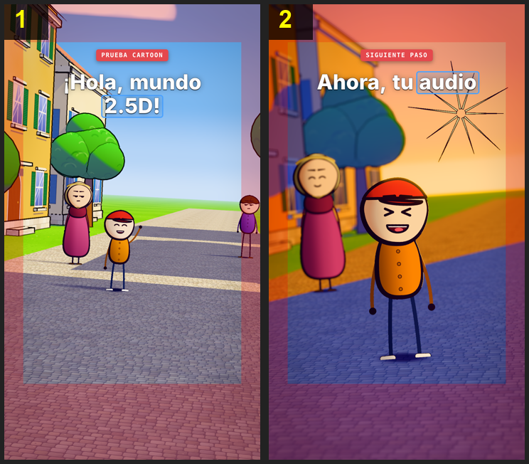

# Cartoon (2.5D): usage



**Flat 2D characters in a painted 3D world.** The characters are cartoon drawings: bean heads, stick limbs, a plum outline, 14 expressions and blinks on their own. They stand as cards that always turn toward the camera. The world is real 3D, built with code:
- painted houses, cobbles, grass and stone
- rounded storybook trees
- black ink lines on every edge
- light in two tones, either **day** or **golden hour** (low sun, violet shadows)
- the background blurs like a real lens, and a colour grade finishes the picture

The look comes from the MIT short [The Bridge That Fell for a Song](https://github.com/mromidev/claude-animated-shorts) (`LICENSE-bridge`). Its look files (`src/toon.ts`, `ink.ts`, `lensblur.ts`, `grade.ts`, `shade.ts`, `lights.ts`, `paint.ts`, part of `build.ts` and `cast.ts`) are kept almost as they came. They run on the **3D style's engine**, so the titles, the safe zone, the preview and the render are the same as in 3D.

**Good for:**
- stories with characters (history, everyday situations, "what happened when…")
- one place where things happen (a street, a square, a house)
- reactions and jokes

**Not for:**
- machines and physics in detail (use 3D)
- lots of text or diagrams (use Flat 2D)

## Steps for a video
The same as 3D (`styles/3d/USAGE.md`), with these changes:
- `scenes.json` says `"style": "2.5d_cartoon"` and `"fps": 30`
- the world goes in `videos/<topic>/world-cartoon.ts`
- the scenes go in `videos/<topic>/visuals-cartoon.ts`

The commands don't change:
```bash
node core/world.ts videos/<topic>
```
```bash
node core/storyboard.ts videos/<topic>
```
```bash
node core/preview.ts videos/<topic>
```
The preview opens on http://localhost:3004 (3D is on 3003, so both can stay open).
```bash
node core/render.ts videos/<topic>
```

## How it's written: one stage, one shot per scene
The whole video normally happens in one set. Build it once in `world-cartoon.ts` and move the camera through it with `CT.shots`, one shot per scene. The full example, with no voice, is `videos/cartoon-demo/`.
```ts
// world-cartoon.ts: the set, built once (prefix every name with the topic: all videos share one global scope)
const PN: { st?: ReturnType<typeof CT.stage> } = {};
const pnInit = (w: World) => {
  const st = PN.st = CT.stage(w, { light: 'day' });
  CT.ground(st, { kind: 'cobble', size: 200, tile: 6 });
  const b = CT.batch();
  CT.house(b, -9, 0, { yaw: Math.PI / 2, h: 8.4, style: 1 });
  CT.tree(b, 4, -6, { kind: 'round', h: 6, seed: 3 });
  CT.build(b, st);
  return st;
};
// visuals-cartoon.ts: each scene only places the camera, the light and the people at time t
CT.shots([
  { id: 'hook', fn(t: number, u: number, s: Scene) {
    const st = PN.st!;
    st.light('day', { view: [0.3, -1] });                       // sun relative to this view, held still
    st.look([1.5, 1.6, 6 - u * 0.5], [0, 1, -4], 40, 3);         // camera: position, target, lens, tilt in degrees
    const joke = s.keys?.find((k) => k.id === 'joke')?.t ?? s.t0 + 1;   // when that key's word is said
    st.person({ id: 1, who: CT.KID, at: [0, 0, -4], front: { mode: 'stand', expr: t > joke ? 'laugh' : 'smile' } });
  } },
], pnInit, (t, u, shot, s) => shot.fn(t, u, s));
```
`u` goes from 0 to 1 through the scene, and `s` is the scene (its keys carry the times of their words).

**The rule:** everything is posed from `t`, and the same `t` must give the same picture, because frames are captured out of order. So:
- no `Math.random()` (use seeds)
- no clocks
- nothing that accumulates from one frame to the next

### The stage (`CT.stage(w)`)
| call | what it does |
|---|---|
| `st.look(pos, target, fov = 40, roll = 0)` | the camera. The target lands in the centre of the frame, which is the centre of the safe zone. The roll (tilt) is in degrees; 3-5° gives the cartoon energy. |
| `st.light('day' \| 'golden', { az, el, view })` | the sun, relative to the camera. `az` is degrees toward screen right (0 = backlight), `el` is its height. Day defaults to 75° / 48°, golden to 6° / 7°. With a moving camera, pass `view: [x, z]` (the shot's main direction) so the light doesn't swim. |
| `st.dof(cInf, focus?)` | lens blur in this frame. `cInf` is the blur of the far background in px: close-up 12-16, medium shot 10-12, wide 0. It focuses on `focus`, by default the look target (aim it at the eyes). |
| `st.person({ id, who, at, … })` | one character in this frame (below). |
| `st.effect(kind, at, size, u)` | a ready-made effect card. The kinds are `burst`, `stars` (dizzy), `puff` (dust), `splash`, `ring` (on water, flat), `note` (music) and `creak` (strain ticks). `u` is its progress from 0 to 1, taken from `t`. |
| `st.card({ key, cw, ch, draw, at, w, h, flat })` | your own flat drawing (a sign, a prop, a speech bubble with no text) on a `cw × ch` canvas, `w × h` metres. |
| `st.add(object)` | anything from `THREE` (it gets the two-tone light if its material comes from `CT.mat`). |

### Characters (`st.person`)
```ts
st.person({
  id: 4,                                  // who it is: its blinks and head shape come from it
  who: CT.townsfolk(2),                   // an outfit, or your own drawing (below)
  at: [x, 0, z],                          // the feet, in metres
  walk: [1, 0],                           // optional: direction it walks; picks front or side view and mirrors it
  side: { mode: 'march', phase: CT.walkPhase(t, 1.2), expr: 'smile', stride: 1 },   // pose when seen from the side
  front: { mode: 'stand', expr: 'grin', look: 1, wave: 0.6 },                       // pose when seen from the front
  scale: 1,                               // 1 = an adult 2.16 m tall (kids come out smaller by their build)
});
```
- **Outfits:** `CT.KID`, `CT.PARENT`, `CT.OFFICER`, `CT.townsfolk(i)` (6 coats, dresses and bonnets, top hats) and `CT.soldier(i)`. You can also make your own: `{ jacket, pants, boots, hat: 'cap' | 'hair' | 'tophat' | 'bonnet' | 'shako' | null, cap, hair, dress, moustache, skin: CT.SKINS[i], build: 'adult' | 'stout' | 'kid' }`.
- **Expressions (`expr`):** `neutral`, `stern`, `grin`, `laugh`, `whistle`, `nervous`, `shock`, `relief`, `relief_open`, `dazed`, `pained`, `smile`, `smile_closed`, `lick`. They change on the word (0-3 frames before it). A blink hides the swap.
- **Front pose (`front`):**
  - `mode`: `stand`, `stroll`, `march`, `sit` or `fall`
  - `phase` (walk cycle) and `look` (-1 left … 1 right)
  - `wave` (0..1, raised arm)
  - `prop`: `'icecream'` or `['hammer', 0..1]`
  - `tilt` and `headTilt` (degrees)
- **Side pose (`side`):** `mode` (`march`, `stand` or `push`), `phase`, `stride` and `stomp`. Side views face screen-right; `walk` or `mirror: true` turns them.
- **Your own character** (an animal, a robot, a mascot): use `who: { key: 'pn-dog', draw: (p, light) => { … } }`. You draw in a 600 × 1000 design space, with the soles at y = 975 (1000 units = 2.16 m). The pen `p` has:
  - `poly`, `ell` and `line` (filled shapes with the ink outline)
  - `shadedFill` and `gradFill` (the painted shadow crescent, away from `light`)
  - `inkRing` (the thick-thin outline), `stroke`, `arc` and `dot`

  The `key` has to change whenever the drawing changes (put the pose in it), because drawings are cached by key.
- Characters never get the world's ink lines (they carry their own) and they get a contact shadow under their feet.

### World pieces
- **Ground:** `CT.ground(st, { kind: 'grass' | 'cobble' | 'stone' | 'planks', size, tile, at })`.
- **Batches:** pieces that never move go in a batch, which is fast. `const b = CT.batch()`, then the pieces, then `CT.build(b, st)`:
  - `CT.house(b, x, z, { yaw, w, d, h, style })`: a gabled house with a painted facade, windows, sills, plinth, cornice and chimney. Its front faces local +z, `h` 7 / 8.4 / 9.8 looks right, and `style` 0-n picks the wall, shutters and roof.
  - `CT.tree(b, x, z, { kind: 'round' | 'fat' | 'tall' | 'cone' | 'bush' | 'hedge', h, seed })`: a rounded storybook plant.
  - `CT.box(b, material, min, max, tile)`: walls, steps, tables, crates.
- **Materials:** `CT.mat(key, '#color')` or `CT.mat(key, { map: texture })` gives the two-tone light that every world surface needs. Painted textures are in `CT.paint`: `grassHD`, `cobbleHD`, `stoneHD`, `planksHD`, `roofHD(color)`, `facadeHD(...)`, `brick` and `rep(texture, x, y)` (repeat).
- **Pieces that move:** use `new THREE.Mesh(geometry, CT.mat(...))` and pose them from `t`.

## Readability rules (from the original's reviews)
- **Every hold creeps.** A static camera for more than a few frames reads as a frozen frame, so push in 0.15-0.35 % per frame (move `pos` a little with `u`).
- **Cut on big jumps** and glide for everything else (smooth 0.6-1.3 s moves). On impacts, shake the camera and flip its sign every frame for 7 frames. The camera is the transition: see [CAMERA.md](CAMERA.md) and `videos/camara-demo/`.
- **Characters are cards:** film them from the front or three-quarter, never edge-on. With a high camera they lean back. Keep the lens about at their chest height.
- **Props closer than ~2 m to the lens** become huge blobs at the edge of the frame. A foreground object must be recognisable or gone.
- **Signs** use pictures, not text (the titles carry the text).
- **Blur on about a third of the screen time** (close-ups, medium shots); establishing and wide shots stay sharp.
- **Day vs golden:** golden hour is for the emotional moments (the end, nostalgia, a twist). Day is for everything else.

## Safe zone and framing
Same as 3D: text, characters and key objects go inside **x 80–1000, y 160–1600**. Aim so that the people stand between y 600 and y 1500. A character 2 m tall fills that band from about 5.5 m away with `fov` 34-40, looking at a point about 1 m above its feet.

## Speed
Every frame draws the world twice (colour, plus normals for the ink), then the blur and the grade. On a Mac with a GPU the 7 s example renders in about 20 s (`hardware gpu`); without a usable GPU it is much slower. Drawings are cached, so many characters in the same pose cost almost nothing.

## Without voice (a quick test)
The same as 3D: give `"duration"`, each scene's `"t0"` and each key's `"t"` in seconds. `world.ts`, `scenes.ts`, `storyboard.ts` and `preview.ts` work the same.
